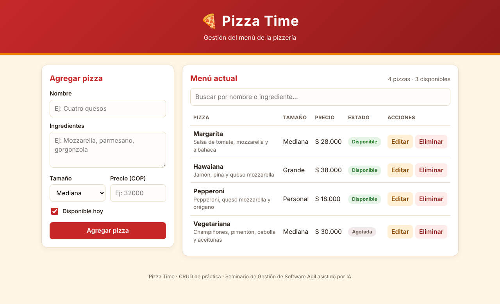
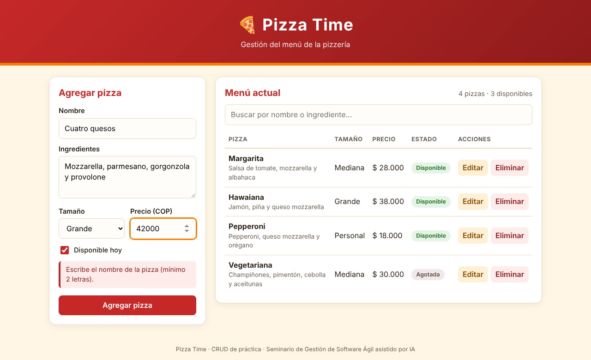
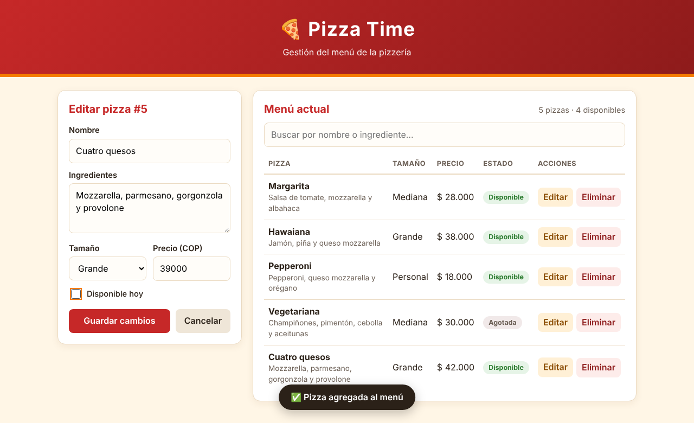
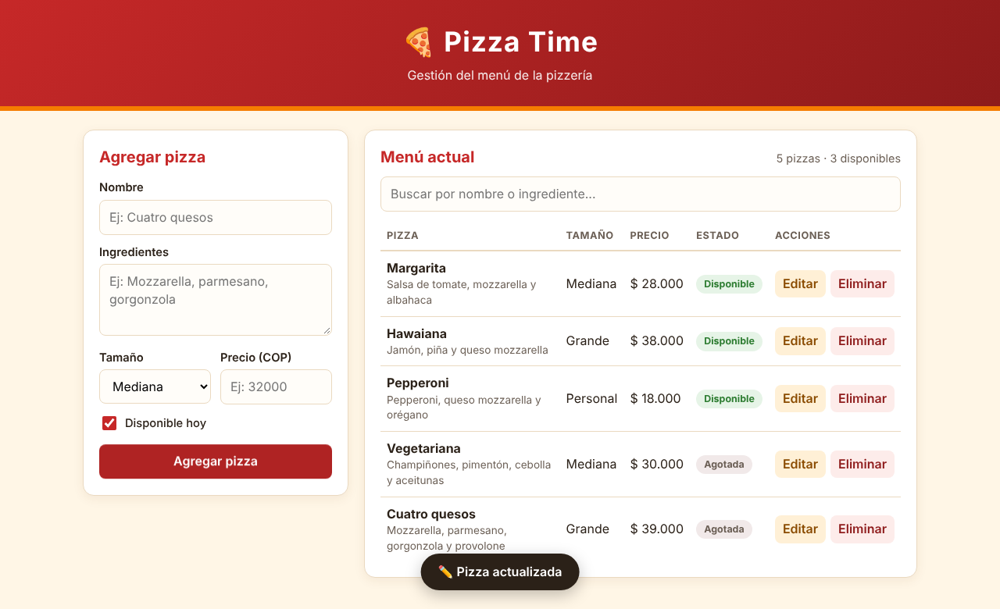
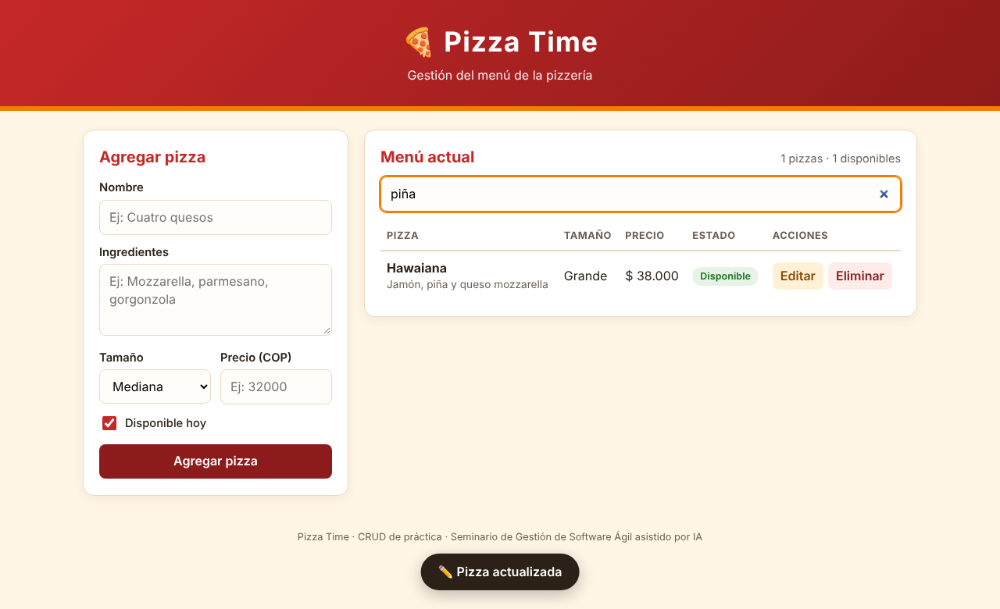
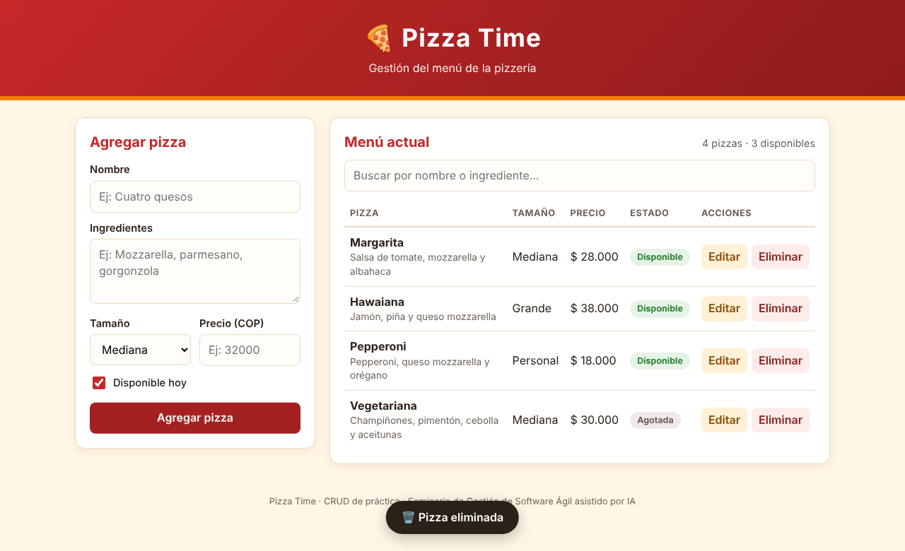
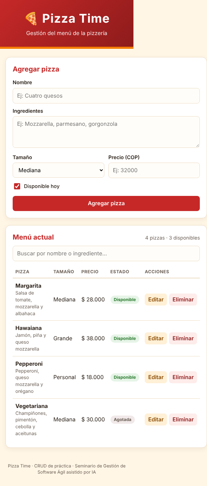

# 🍕 Pizza Time — CRUD del menú de una pizzería

Aplicación web sencilla para administrar el menú de la pizzería **Pizza Time**: permite **crear, ver, editar y eliminar** pizzas. Fue desarrollada con ayuda de inteligencia artificial (Claude) como trabajo práctico del seminario *Gestión de Software Ágil asistido por Inteligencia Artificial*.

🎥 **Video explicativo:** _(https://drive.google.com/file/d/1EeCLjpsKKShXf_9FUgHlaKinWghVY6xD/view?usp=drivesdk)_

---

## Descripción

El administrador de la pizzería puede:

- Agregar una pizza nueva con nombre, ingredientes, tamaño, precio y disponibilidad.
- Ver todo el menú en una tabla, con el conteo de pizzas disponibles.
- Buscar pizzas por nombre o ingrediente.
- Editar los datos de una pizza (por ejemplo, cambiar el precio o marcarla como agotada).
- Eliminar una pizza del menú (con confirmación).

Los datos se guardan en un archivo JSON, así que **no necesita instalar ninguna base de datos**.

## Tecnologías utilizadas

| Parte | Tecnología |
|---|---|
| Página web | HTML5 y CSS3 (sin frameworks) |
| Lógica del navegador | JavaScript (fetch API) |
| Servidor | Node.js (solo módulos incluidos: `http`, `fs`, `path`) |
| Almacenamiento | Archivo JSON (`data/pizzas.json`) |
| Herramienta de IA | Claude (Anthropic) |

No tiene dependencias externas: no hace falta ejecutar `npm install`.

## Cómo ejecutar el proyecto

**Requisito:** tener [Node.js](https://nodejs.org) versión 18 o superior.

```bash
# 1. Clonar el repositorio
git clone <URL-DEL-REPOSITORIO>
cd pizza-time-crud

# 2. Iniciar el servidor
npm start
```

3. Abre el navegador en **http://localhost:3000**

Si el puerto 3000 está ocupado, puedes usar otro:

```bash
PORT=4000 npm start        # Linux / Mac
set PORT=4000 && npm start # Windows (cmd)
```

La primera vez que se inicia, el servidor crea `data/pizzas.json` con 4 pizzas de ejemplo.

## Cómo funciona cada parte del CRUD

| Operación | Qué hace el usuario | Función en `public/app.js` | Petición al servidor |
|---|---|---|---|
| **C**reate (crear) | Llena el formulario y presiona *Agregar pizza* | `crearPizza()` | `POST /api/pizzas` |
| **R**ead (leer) | Abre la página o usa el buscador | `leerPizzas()` | `GET /api/pizzas` |
| **U**pdate (actualizar) | Presiona *Editar*, cambia datos y *Guardar cambios* | `actualizarPizza()` | `PUT /api/pizzas/:id` |
| **D**elete (eliminar) | Presiona *Eliminar* y confirma | `eliminarPizza()` | `DELETE /api/pizzas/:id` |

El servidor (`server.js`) valida cada pizza antes de guardarla y responde con el código HTTP correcto: `200` (ok), `201` (creada), `400` (datos inválidos) o `404` (no existe).

### Reglas de validación

- **Nombre:** entre 2 y 40 caracteres.
- **Ingredientes:** entre 3 y 120 caracteres.
- **Tamaño:** `Personal`, `Mediana` o `Grande`.
- **Precio:** número mayor que 0 y hasta 500.000 (pesos colombianos).

## Estructura del proyecto

```
pizza-time-crud/
├── server.js          # Servidor + API REST del CRUD
├── package.json       # Información del proyecto y comando "npm start"
├── public/            # Lo que ve el usuario en el navegador
│   ├── index.html     # Estructura de la página
│   ├── style.css      # Colores y diseño
│   └── app.js         # Lógica del CRUD en el navegador
├── data/
│   └── pizzas.json    # Datos (se crea solo al iniciar)
└── docs/screenshots/  # Capturas de pantalla
```

## Capturas de pantalla

**1. Lista inicial del menú**



**2. Crear: formulario lleno**



**3. Crear: pizza agregada al menú**


**4. Actualizar: editando una pizza**



**5. Actualizar: cambios guardados (precio nuevo y estado «Agotada»)**



**6. Leer: búsqueda por ingrediente**



**7. Eliminar: pizza eliminada**



**8. Vista en celular**



## Prompts utilizados

El desarrollo se guía con seis prompts, en este orden. Después de cada paso se ejecuta y se prueba el resultado antes de pasar al siguiente.

### Prompt 1 — Planificación

```text
Actúa como mentor de desarrollo web para estudiantes principiantes. Necesito un CRUD sencillo para una pizzería llamada Pizza Time, para el seminario de Gestión de Software Ágil asistido por IA. Propón: (1) qué entidad se va a gestionar y qué campos tiene, (2) las tecnologías más simples posibles (HTML, CSS, JavaScript y Node.js sin librerías externas), (3) la estructura de carpetas y (4) el plan en pasos pequeños. No escribas código todavía; explica cada decisión en lenguaje fácil.
```

**Qué pedí y para qué:** definir el alcance antes de programar. Es la forma ágil de empezar: una entidad (pizza), pocos campos y pasos pequeños que se puedan probar uno por uno.

### Prompt 2 — Servidor y API (Create, Read, Update, Delete)

```text
Con el plan anterior, crea server.js usando solo módulos de Node (http, fs, path). Guarda las pizzas en data/pizzas.json y crea el archivo con 4 pizzas de ejemplo si no existe. Haz la API REST /api/pizzas: GET (lista, con ?buscar=), GET /:id, POST, PUT /:id y DELETE /:id. Campos: id, nombre, ingredientes, tamano (Personal, Mediana, Grande), precio (COP) y disponible (booleano). Valida los datos y responde con códigos HTTP correctos (200, 201, 400, 404). Comenta el código en español, sencillo para principiantes.
```

**Qué pedí y para qué:** obtener el backend completo con las cuatro operaciones del CRUD, validación y datos de ejemplo, sin instalar librerías.

### Prompt 3 — Página y diseño

```text
Crea public/index.html y public/style.css para Pizza Time: encabezado rojo y naranja, formulario a la izquierda (nombre, ingredientes, tamaño, precio y disponible) y tabla de pizzas a la derecha con buscador y botones Editar y Eliminar. Debe verse bien en celular. Sin frameworks.
```

**Qué pedí y para qué:** generar la interfaz con la identidad de la pizzería (colores cálidos) y que funcione también en pantallas pequeñas.

### Prompt 4 — Conexión con el servidor (JavaScript)

```text
Crea public/app.js usando fetch. Debe tener una función por cada operación del CRUD: leerPizzas, crearPizza, actualizarPizza y eliminarPizza (con confirmación). El mismo formulario sirve para agregar y para editar. Muestra un aviso cuando algo sale bien y un mensaje de error cuando el servidor rechaza los datos. Comenta cada parte en español.
```

**Qué pedí y para qué:** conectar la página con la API. Una función por letra del CRUD hace que el código sea fácil de explicar y de entender.

### Prompt 5 — Refactorización

```text
Refactoriza el código para que sea más seguro y fácil de entender: usa textContent en vez de innerHTML para evitar inyección de HTML, evita que el servidor permita leer archivos fuera de la carpeta public, separa funciones pequeñas que hagan una sola cosa, valida en el navegador y en el servidor y elimina código repetido. Explícame cada cambio y por qué lo hiciste.
```

**Qué pedí y para qué:** mejorar la calidad del código sin cambiar lo que hace la aplicación (seguridad básica, funciones cortas y menos repetición).

### Prompt 6 — Pruebas y documentación

```text
Dame los comandos curl para probar cada operación del CRUD (incluyendo los errores de validación) y una lista de pruebas manuales para el navegador. Luego redacta un README.md para el repositorio con: nombre, descripción, tecnologías, instrucciones para ejecutar, estructura del proyecto y capturas de pantalla.
```

**Qué pedí y para qué:** comprobar que todo funciona y dejar el proyecto documentado para que otra persona pueda ejecutarlo.

## Pruebas realizadas

- **API (curl):** crear (201), leer lista y una pizza (200), editar (200), eliminar (200), búsqueda por texto, y los errores esperados: datos inválidos (400), JSON roto (400) y pizza inexistente (404).
- **Navegador (automatizado con Playwright):** crear, editar, buscar, eliminar con confirmación, cancelar la eliminación, validación del formulario vacío y vista en celular, sin errores en la consola.
- **Seguridad básica:** un nombre con código HTML (`<b>…</b>`) se muestra como texto y no se ejecuta.

## Posibles mejoras

- Cambiar el archivo JSON por una base de datos (SQLite o MongoDB).
- Agregar fotos de las pizzas y categorías (clásicas, vegetarianas, especiales).
- Agregar inicio de sesión para que solo el administrador pueda editar.

---

**Autor:** _(Andrey Mauricio Perdomo Trujillo)_ · Seminario de Gestión de Software Ágil asistido por Inteligencia Artificial
